<div align="center">

# Doodle Duel

**Your sketch is your weapon.**

[](#provenance)
[](#verification-status)
[](#how-it-works)
[](#the-deep-agents)
[](docs/REFERENCE.md)

</div>

<p align="center">
  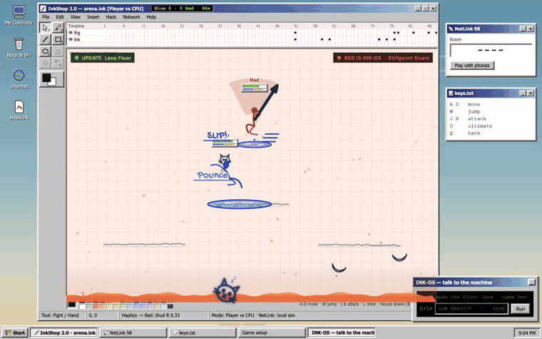
</p>

<p align="center"><sub>A fight with a "make the floor lava" update installed. Blue is holding a cat. Partway through, Red runs a hack and Blue has to draw an X to cancel it.</sub></p>

<div align="center">

|  |  |  |  |
|:---:|:---:|:---:|:---:|
| **about 2 s** | **about 20 s** | **about 6 s** | **0 dependencies** |
| drawing to weapon | typed request to live | the machine re-arms | in the game server |

</div>

## Contents

- [Why it is different](#why-it-is-different)
- [How it works](#how-it-works)
- [A drawing becomes a weapon](#a-drawing-becomes-a-weapon)
- [Talking to the machine](#talking-to-the-machine)
- [Nemesis](#nemesis)
- [The deep agents](#the-deep-agents)
- [The headgear](#the-headgear)
  - [Link and safety](#link-and-safety)
- [Limitations](#limitations)
- [Verification status](#verification-status)
- [Run it](#run-it)
- [Repository](#repository)
- [Provenance](#provenance)

Doodle Duel is a 1v1 stick-figure fighter where every weapon is something you drew on your
phone. A vision model says what the drawing is, the ink you spent sets how strong it is, and
an unexpected idea earns abilities that the model writes as code for that one drawing.

The fight happens inside a pretend 1990s desktop, and that computer is an AI agent. Type
"make the floor lava" and it designs the change, play-tests it in real matches and installs
it into the fight you are in. Play against it, and it studies how you fight, builds weapons
to counter you, and remembers you the next time.

> Doodle Duel is a hackathon prototype built in about a day. Parts of it have only been tried
> against scripted players. See [what has been verified](#verification-status).

## Why it is different

| Common approach | Where it falls short |
|---|---|
| Drawing games that judge or guess your drawing | The drawing stops mattering the moment it is scored. After that you watch. |
| Games with AI-generated content | The output is trusted. Nothing tests it, so it either stays cosmetic or it breaks the game. |
| Bots with a difficulty slider | Harder is not smarter. It plays everyone the same way and forgets you. |

Doodle Duel's answer:

1. **What you draw is what you hold.** The sword, banana or cat is in your fighter's hand two
   seconds after you finish it. A messy drawing is as strong as a neat one: the model never
   judges effort.
2. **Powers are code, written per drawing.** Abilities are short scripts in a language the
   game interprets itself. Nothing a model writes is ever run as JavaScript.
3. **The game can be rewritten while you play it.** A typed request becomes an update that has
   to pass a play-test before it reaches the match.
4. **The opponent studies you.** It reads your habits as numbers, builds against them, and
   practises on a copy of you before the next round.
5. **It says what it has not tested.** Every claim on this page is marked as measured, seen
   once, or not yet tried.

## How it works

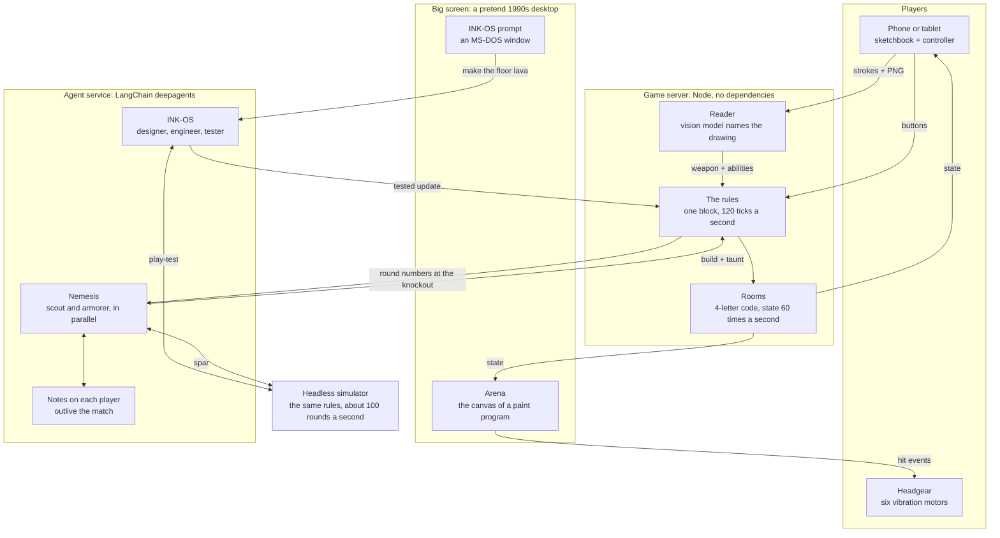

1. **Draw.** Before each round both players draw two things and split 100 ink between them.
   Phones join by scanning a QR code and become sketchbook and controller; nobody installs
   anything. On the big screen a Loadouts window shows what each player has made so far.
2. **Fight.** First to two rounds, each up to 90 seconds. The server owns the match: it steps
   the rules 120 times a second and sends the state to every screen 60 times a second. Phones
   only send buttons.
3. **The machine.** One window on that desktop is an MS-DOS Prompt titled INK-OS. That prompt,
   and the bot you can fight, are two deep agents running beside the game server.

The rules exist once, as a marked block in `duel.html` that the page and the server both run.
All of a match's randomness comes from one seed and every command is logged with its tick, so
a match can be replayed exactly and, more usefully, played with nobody watching. That headless
simulator is what the agents are built on.

More figures: [one drawing](docs/diagrams/drawing-to-weapon.svg),
[a typed request](docs/diagrams/ink-os.svg), [Nemesis](docs/diagrams/nemesis.svg),
[where the waiting hides](docs/diagrams/timeline.svg) and
[the headgear](docs/diagrams/headgear.svg). They are drawn by
[`docs/diagrams/make-diagrams.js`](docs/diagrams/make-diagrams.js).

## A drawing becomes a weapon

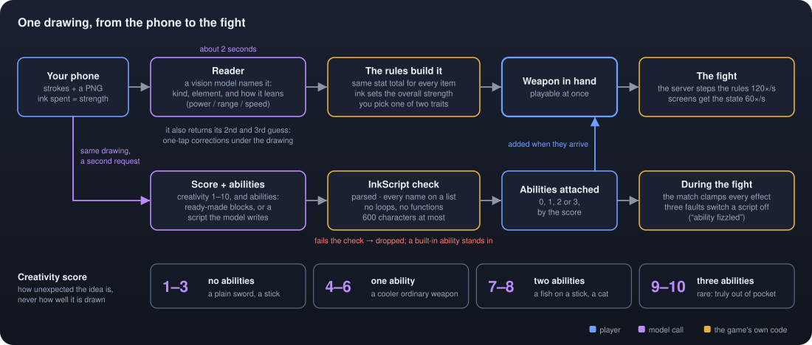

You draw and press Make it. The strokes and a PNG go to the server; the API key never reaches
a browser. One request to a vision model comes back with a name, a kind (melee, ranged, bomb,
shield, dash or heal), an element, and how the thing leans between power, range and speed.
The reader's second and third guesses sit under the drawing as buttons, so a wrong read costs
one tap.

A second request, a few seconds behind, scores the idea from 1 to 10 and writes its abilities.
The game has 59 ready-made behaviours, each with a visible tell: healing orbs, a fire trail, a
summoned pet, wind across the stage. The model picks among them and writes a short script
saying when they fire, or codes something new from lower-level pieces such as pushes, hops,
shots and stuns.

<p align="center">
  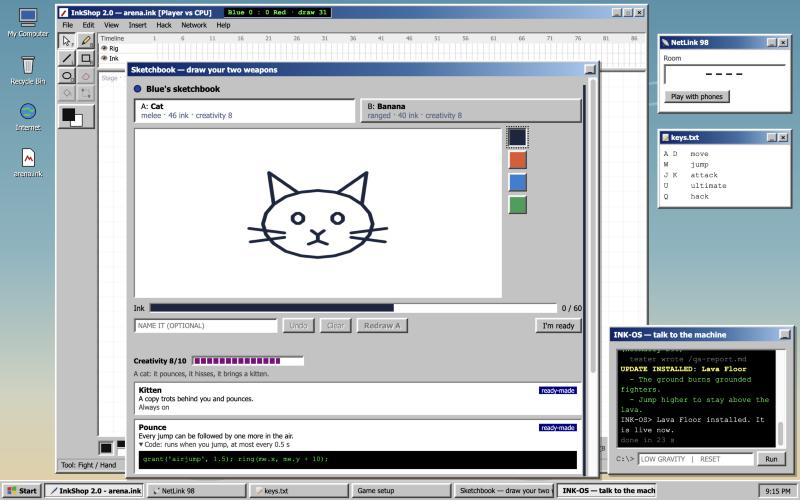
</p>

<p align="center"><sub>The Sketchbook. The card under a drawing shows its score and each ability, with the code behind it. This cat is one of the ready-made weapons; a drawn one gets the same card.</sub></p>

The scripts are in **InkScript**, a language we wrote for this ([`inkscript.js`](inkscript.js)).
The game parses it, checks every name against a table and interprets it itself.

| Decided by the model | Decided by the game |
|---|---|
| What the drawing is, and its name | How strong it is: only the ink you spent |
| How it leans between power, range and speed | The total of those three, the same for every item |
| How unexpected the idea is, 1 to 10 | How many abilities that score buys: 0, 1, 2 or 3 |
| The ability scripts | What a script may call, how hard each call may hit, and when a script is switched off |

Reading speed was a choice. With the model allowed to think, it read 12 of 14 test drawings
correctly but took 5 seconds each. Without, 8 of 11 in 2 seconds. We took 2 seconds and the
one-tap corrections.

## Talking to the machine

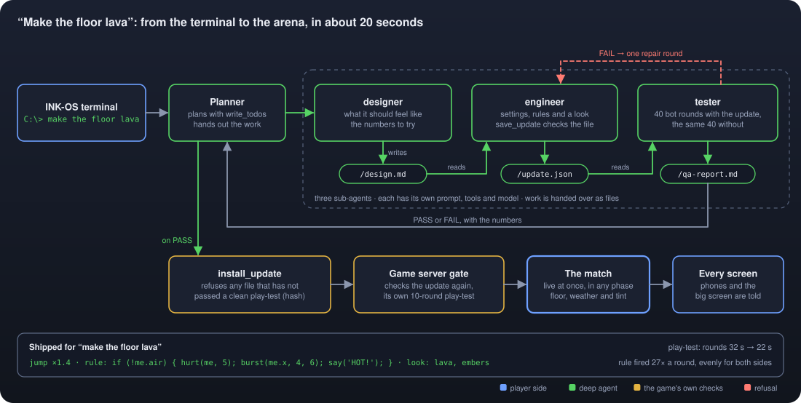

One window on the desktop is an MS-DOS Prompt titled INK-OS. A request typed there goes to
**INK-OS**, a deep agent that plans the job and runs three sub-agents who hand work to each
other as files. Everything they do scrolls past in the prompt while it happens:

<p align="center">
  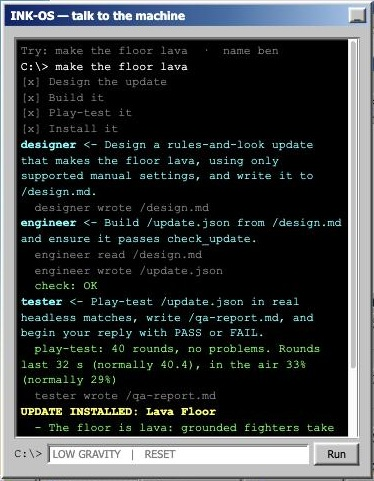
</p>

<p align="center"><sub>A real run, 22 seconds from Enter to installed.</sub></p>

What comes out is an update, and an update is data:

| Part | What it may hold |
|---|---|
| Settings | `gravity` 0.25–2.5, `speed` 0.5–1.8, `jump` 0.6–1.8, `damage` 0.4–2.5, `knockback` 0.4–3, `shotSpeed` 0.4–2, `size` 0.4–1.6, `health` 0.25–1, `overdrive` 0.5–4 (multipliers) |
| World rules | Up to three InkScript scripts that run for both fighters. They may push, hop, dash, burn, soak, stun, heal or hurt |
| Look | A floor (lava, ice, slime, void, grass), weather (embers, rain, snow, stars, sparks, wind, bubbles) and a tint. Only the page draws these |

The tester's tool plays 40 seeded rounds between two bots with the update, beside the same 40
without it, and flags what it finds:

| Flag | Meaning |
|---|---|
| `CRASH`, `BROKEN`, `FAULTS` | A match threw, a fighter ended up with impossible numbers, or a rule kept failing |
| `DEAD RULE` | A rule never fired in any round |
| `TOO DEADLY` | Rounds last under 6 seconds |
| `TOO SLOW` | More than 45% of rounds run out the clock |
| `ONE-SIDED` | One side wins more than 70% of decided rounds, or the rules fire mostly for one side |

- **Three checks stand between a model and a match.** The engineer's tool validates the file.
  The install tool refuses any file that has not passed a clean play-test unchanged; it
  compares a hash. The game server then runs its own 10-round play-test before the update
  reaches a room.
- **It is live at once.** An update lands in whatever phase the match is in. It arrives as a
  message box, and a label stays on the stage for as long as it is installed. Type `reset` to
  remove it.
- **About 20 seconds, 10 model calls.** The first version took 30 to 50 seconds and about 17.

<p align="center">
  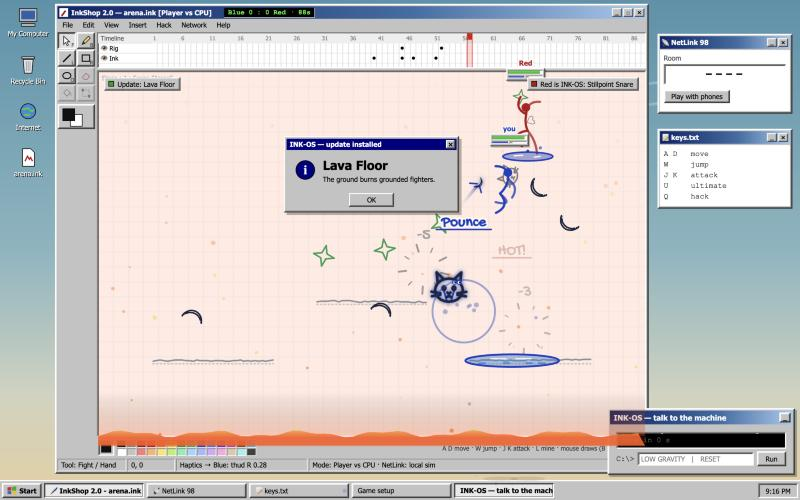
</p>

<p align="center"><sub>The update landing mid-fight.</sub></p>

## Nemesis

<p align="center">
  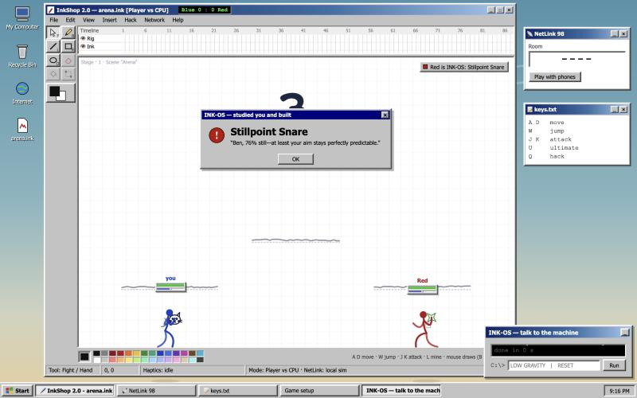
</p>

Against the bot, Red is played by the machine. It is a second deep agent, and it starts work
the moment a round is won.

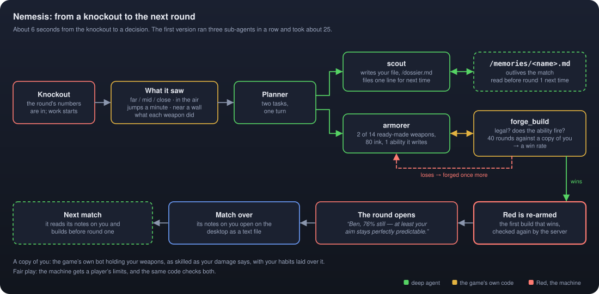

The rules keep numbers on each fighter every round. These are what it studies:

| Measured each round | Used for |
|---|---|
| Share of the round spent far, mid and close | The copy of you keeps your distance |
| Time in the air, jumps a minute | The copy jumps as often as you do |
| Time backing away, standing still, near a wall, behind a shield | The scout's write-up and the taunt |
| Uses and damage of each weapon; damage taken | How skilled the copy is, and what to counter |

- **Fair play.** The machine gets what a player gets: two of the fourteen ready-made weapons,
  80 ink between them, and one ability it writes in InkScript (two when it is behind). The
  same code checks its build and a player's.
- **It practises before it commits.** The forge tool tests the ability in staged fights, then
  spars the build for 40 rounds against a copy of you. A build that loses is forged once more.
  If its old weapons are clearly better, it keeps them and says so.
- **It remembers.** The scout adds one line to `os-agent/memory/<name>.md` after every round
  and reads it before round one of your next match. Type `name ben` into the prompt to tell
  it who you are.
- **About 6 seconds.** It starts at the knockout, so it has usually decided by the time
  drawing opens. A refused ability or a losing first build makes it about 13.

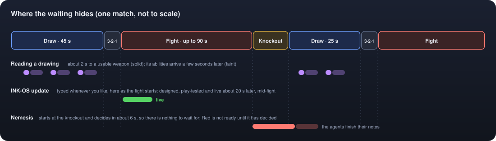

## The deep agents

Both agents are built on LangChain's [`deepagents`](https://github.com/langchain-ai/deepagentsjs)
and live in [`os-agent/`](os-agent). Each part of the library does something a player can see.

| deepagents feature | Where it is used |
|---|---|
| Planning (`write_todos`) | Both agents open with a plan. It is the first thing a player sees: a checklist in the INK-OS prompt that ticks off as the work moves |
| Sub-agents (`task`) | Five across the two agents, each with its own prompt, tools and model: designer, engineer and tester for INK-OS; scout and armorer for Nemesis, started in the same turn so they run in parallel |
| File system (`FilesystemBackend`) | Every run gets its own workspace. Work is handed over as files: `/design.md`, `/update.json`, `/qa-report.md`, `/dossier.md`, `/build.json`, `/spar-report.md`. The folders stay on disk in `os-agent/work/` |
| Long-term memory (`CompositeBackend`) | `/memories/` is routed to a folder that outlives the match. That is how the machine knows you the second time |
| Custom tools | Seven, wrapping the game's own checker and simulator: `save_update`, `check_update`, `playtest`, `install_update`, `forge_build`, `remember`, `deploy` |
| Streaming with sub-graphs | Every plan step, hand-over, file write and test result becomes a line in the prompt while it happens |
| Models per role (`@langchain/openai`) | A small model plans and routes; a larger one writes |

Why an agent and not a chain of prompts: it loops on evidence. When the armorer wrote an
ability with too narrow a condition, the forge tool refused it with *"the ability never fired
in the test fight: five hits landed, one of them on a soaked foe, and the code never did
anything"*, and the next attempt fixed it. The simulator, not the prompt, decides what ships.

## The headgear

<p align="center">
  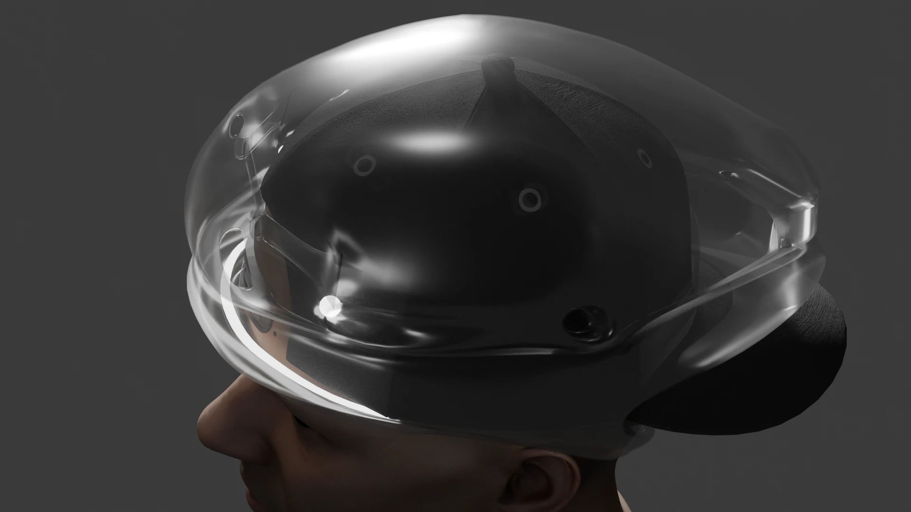
</p>

<p align="center"><sub>Concept render.</sub></p>

One player can wear the fight. Six vibration motors sit around the head, and each hit arrives
from the side it came from.

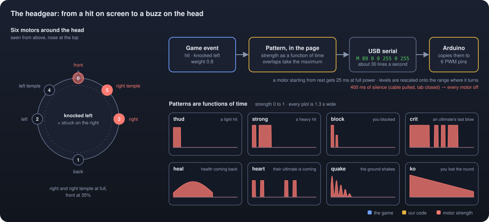

| Part | Spec |
|---|---|
| Controller | Arduino Uno or Nano, on USB |
| Actuators | 6 vibration motors: front, back, left, right, left temple, right temple, on PWM pins 3, 5, 6, 9, 10, 11 |
| Driver | [`haptics.js`](haptics.js) in the game page, over Web Serial at 115200 baud (Chrome or Edge on a computer) |
| Patterns | 13, each a function of time. They overlap by taking the strongest level, so nothing queues |
| Firmware | [`hardware/headband/headband.ino`](hardware/headband/headband.ino) |

What the wearer feels:

- A hit that knocks you left buzzes your right side and right temple; a heavy one is a short
  pulse and a long one.
- Fire flickers at random across all six motors, water is a cold shiver, plant swells and fades.
- Your own ultimate circles the head. The other player's ultimate is a heartbeat.
- A lost round fades out. A won one goes temples, sides, then everything.

Nothing in the rules or the server knows the headgear exists. The page listens to the same
events that draw the fight, so the game runs unchanged without it, and tuning a pattern takes
a browser refresh, not a reflash. Connect it from Game setup with **Headband: off**, and pick
who is wearing it with **Worn by**.

### Link and safety

- **Protocol:** one text line of six levels, `M <front> <back> <left> <right> <left temple> <right temple>`,
  each 0 to 255, about 30 times a second while a pattern is playing. The board only copies
  them to its pins, so the delay from a hit to the buzz is one serial line.
- **Watchdog:** if the lines stop for 400 ms (cable pulled, tab closed) every motor switches off.
- **Starting a motor:** a motor starting from rest gets 25 ms at full power, and levels are
  rescaled onto the range where a motor actually turns.
- **By hand:** the firmware also takes typed commands such as `hit,left,0.8` and `test` from a
  serial monitor, for checking the wiring without the game.
- **Known limit:** the board reports nothing back, so the game cannot tell whether a motor is
  turning.

## Limitations

- **The copy of you is rough.** It is the game's bot with your weapons and a handful of your
  numbers laid over it. A build that wins 90% of its practice rounds has beaten that model,
  not you.
- **Agents are slow next to a fight.** Twenty seconds is fine for an update and six is fine
  between rounds, but neither could sit inside a single exchange of blows. That is why a
  drawing's abilities are read and checked but not test-fought before they land.
- **The machine needs a laptop.** The agent service runs beside the game server. The public
  deployment runs only the game server, so there the prompt stays quiet and the bot keeps
  its ready-made weapons.
- **Balance came from bots.** The numbers were tuned by simulated matches, not by people.
- **Rooms live in memory,** so a deployment has to be a single instance, and restarting the
  server closes every room.

With more time we would:

1. **Put real players in front of Nemesis** and find out whether its builds beat people or
   only its model of them.
2. **Put the agent behind every drawing.** A weapon is already playable before its abilities
   arrive, so an agent could write, test-fight and repair them in that gap.
3. **Let the machine act unasked,** patching the game between rounds from what it saw.
4. **Host the agent service** next to the public game server.

## Verification status

What has run, and what has not:

- **Passes:** `node tools/test-abilities.js`, 24 of 24 checks on the ability language, its
  checker and the prompts. Headless bot matches, sparring and update play-tests run on the
  current rules.
- **Seen working in a desktop browser:** a full match against the bot on the desktop; the lava
  update designed, play-tested and installed; Nemesis rebuilding between rounds, and from its
  notes at the start of a second match; a server room with a scripted player; jumping while
  attacking, 8 of 8 with real key presses.
- **Known failing:** `node tools/test-replay.js` fails 10 of its 60 checks on the current main
  and has not been investigated. `tools/test-world.js` does not run. The trained CPU's weights
  were made under older rules; the server says so at start.
- **Not yet tested:** real people against Nemesis; phones on a venue's network with the agent
  service; the newest movement and touch controls beyond throwaway scripts; the game driving
  the real headgear board.

## Run it

Requirements: Node 18 or newer. The game server has no dependencies. The agent service has
six, installed with npm.

```sh
cp .env.example .env                              # put your OpenAI key after OPENAI_API_KEY=
node server.js                                    # the game: http://localhost:3000
cd os-agent && npm install && node server.mjs     # the machine: INK-OS and Nemesis, port 3130
```

Without a key the game still runs: drawings are read by a rough local guess from ink colour
and shape. Without the agent service the game still runs: the prompt says the machine is not
answering, and the bot keeps its ready-made weapons.

Choose **Player vs Bot** or **Player vs Player** and scan the code with a phone, or choose
**vs Bot** under "On this device" to draw and play with the keyboard (A/D move, W jump,
J and K use your two drawings).

| Variable | Default | What it does |
|---|---|---|
| `OPENAI_API_KEY` | none | Key the server and the agent service use. It never reaches a browser |
| `OPENAI_MODEL` | `gpt-6-luna` | Vision model that reads a drawing |
| `OPENAI_ABILITY_MODEL` | `OPENAI_MODEL` | Model that scores a drawing and writes its abilities |
| `PORT` | `3000` | Port the game server listens on |
| `OS_AGENT_URL` | `http://127.0.0.1:3130` | Where the game server finds the agent service |
| `OS_AGENT_MODEL` | `gpt-6-luna` | Model for INK-OS |
| `NEM_MODEL`, `NEM_BUILD_MODEL` | `gpt-5.4-nano`, `gpt-5.4-mini` | Models for Nemesis: planning, and the two sub-agents |

```sh
node tools/test-abilities.js          # the ability language and its checks
node tools/balance.js quick --seed=7  # the same bot rounds every time
node docs/diagrams/make-diagrams.js   # redraw the figures on this page
```

Headgear: flash [`hardware/headband/headband.ino`](hardware/headband/headband.ino), set its six
pins to match your wiring, open the game in Chrome or Edge, and press **Headband: off** in
Game setup.

## Repository

| Path | Contents |
|---|---|
| [`duel.html`](duel.html) | The game page. The rules sit in a marked block that the server runs too, so there is one copy |
| [`duel-server.js`](duel-server.js), [`server.js`](server.js) | The game server: rooms, the reader, and the gates in front of the agents |
| [`inkscript.js`](inkscript.js), [`abilities.js`](abilities.js) | InkScript (parser, checker, interpreter), and the code that prompts for abilities and checks what comes back |
| [`osforge.js`](osforge.js) | What an update is: its manual, its validator and its play-test |
| [`nemesis.js`](nemesis.js) | What a build is: its manual, its validator, the copy of a player and the sparring |
| [`os-agent/`](os-agent) | The two deep agents: `server.mjs` (INK-OS) and `nemesis.mjs` |
| [`haptics.js`](haptics.js), [`hardware/headband/`](hardware/headband) | The headgear's patterns and serial link, and its firmware |
| [`inkshop.js`](inkshop.js), `inkshop.css` | The 1990s desktop and paint program the fight happens in |
| [`anim/`](anim) | Animation clips and the springy rig that plays them |
| [`ws.js`](ws.js), [`wire.js`](wire.js) | An optional WebSocket link with binary state deltas |
| [`bot/`](bot), [`tools/`](tools) | A trained CPU and its trainer; tests, a balance bench and a stand-in model |
| [`docs/`](docs) | [The full reference](docs/REFERENCE.md), the figures and the script that draws them |

## Provenance

Doodle Duel was built at HackPrinceton in about a day: 200 commits on 27 branches. The first
version was a one-lane battler where you drew units and watched them march. It was removed,
and the repository still carries its name.

The desktop the fight happens on began as Alex's InkShop prototype. His interface, shape
recogniser, hack table and effects are in the page as he wrote them, between BEGIN and END
markers in `inkshop.js`, `inkshop.css` and the `INK` block of `duel.html`. `qrcode.js` is
Kazuhiko Arase's QR Code Generator (MIT).

Much of the code was written with Claude Code working alongside us, and those commits carry
its co-author line.

[The full reference](docs/REFERENCE.md) is the longer write-up of every mechanic: specials,
ultimates, hacks, the spreadsheet and slideshow stages, replays, the trained CPU and the
WebSocket link.
